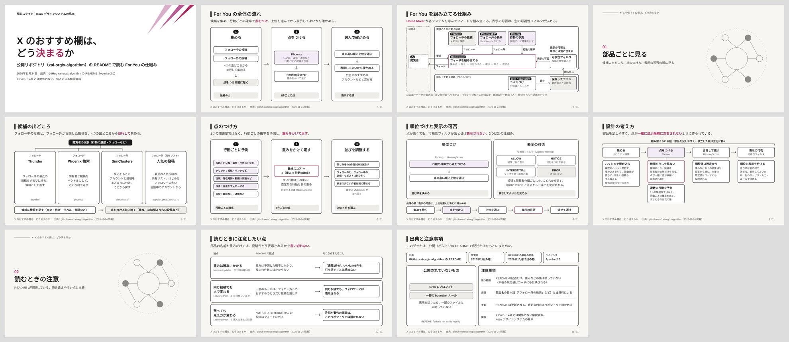
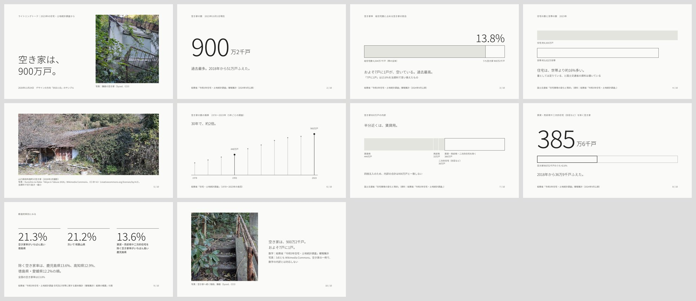
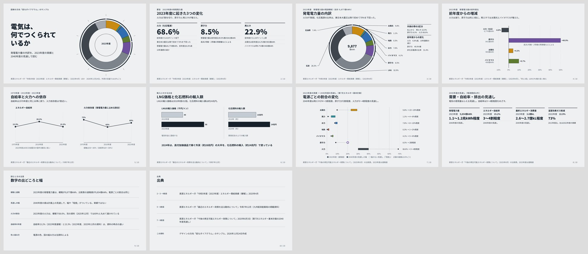
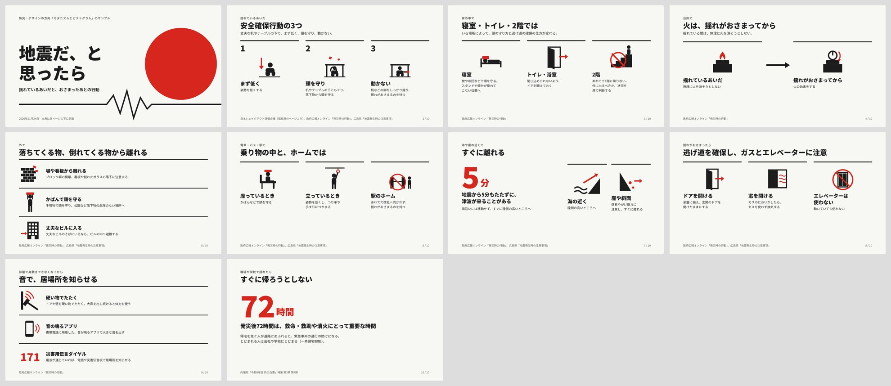
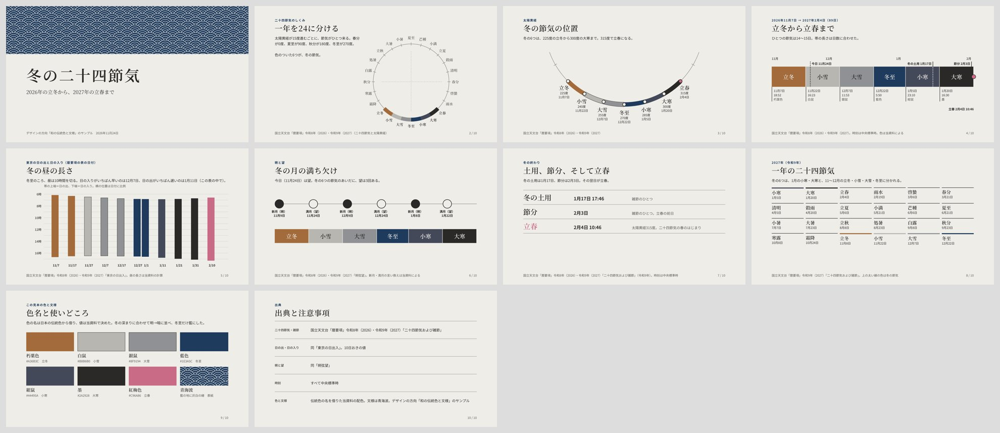

# slide-design-kit

スライドのデザインシステム6つと、それぞれを使って作った見本のスライド5本です。AI（Claude）にスライドを作ってもらうときの「見た目の決まり」として使えます。AI を使わない人も、PowerPoint や Googleスライドで色と組み方を真似できます。

Biz-Terrace.ai の勉強会で配るために公開しています。

## 入っているもの

### 見本のスライド

| 見本 | デザインシステム | 向いている資料 |
|---|---|---|
| [X のおすすめ欄は、どう決まるか](samples/x-algorithm/)  | [Kozu](design-systems/kozu/) | 構成図・流れ・画面や会話のイメージが主役の解説 |
| [空き家は、900万戸。](samples/akiya/)  | [余白](design-systems/yohaku/) | 大きな1文・1つの数字・写真で見せる短い発表 |
| [電気は、何でつくられているか](samples/denki/)  | [密図](design-systems/mitsuzu/) | たくさんの数字の関係を1枚で見せる分析・報告 |
| [地震だ、と思ったら](samples/jishin/)  | [標識](design-systems/hyoshiki/) | 行動・手順・注意を記号で伝える資料 |
| [冬の二十四節気](samples/sekki/)  | [和色](design-systems/washoku/) | 暦・季節・和の題材 |

PDF と PPTX は [Releases](https://github.com/yamamonlab/slide-design-kit/releases) にあります。

### デザインシステム

| フォルダ | 役割 |
|---|---|
| [`design-systems/kiban/`](design-systems/kiban/) | **Kiban（共通の基盤）**。どの見た目でも変えない決まり（読みやすさ・文章・1枚の骨格・デッキの型）と、システムの選び方。ほかの5つはこれに従う |
| [`design-systems/kozu/`](design-systems/kozu/) ほか5つ | 個別の見た目。それぞれ `README.md`（決まり）・`tokens.json` と `tokens.css`（色・文字・余白の値）・`components/`（部品の見本）・`slides.md`（スライドの書き方の見本）を持つ |

## 3分で始める

1. 右上の **Code → Download ZIP** でこのリポジトリを手元に保存し、展開する。
2. [見本](#見本のスライド)を見て、作りたい資料に近いものを1つ選ぶ。
3. [`docs/はじめての人へ.md`](docs/はじめての人へ.md) の手順どおりに、そのデザインシステムを Claude に渡すか、PowerPoint・Googleスライドに色を写す。

| 読むもの | 中身 |
|---|---|
| [はじめての人へ](docs/はじめての人へ.md) | 取り込みから1枚目のスライドまでの手順（Claude を使う道／使わない道） |
| [依頼文の例](docs/依頼文の例.md) | 資料の型ごとの、コピーして使える依頼文 |
| [チェックリスト](docs/チェックリスト.md) | できあがったスライドを確かめる項目 |

## ライセンス

- このリポジトリの文章・デザインシステム・見本のスライド・スクリプトは [MIT ライセンス](LICENSE) です。
- 写真・統計・参照した資料には、それぞれの利用条件があります。再配布するときは [CREDITS.md](CREDITS.md) を確かめてください。
- 書体（Noto Sans JP / Noto Serif JP）は同梱していません。Google Fonts から読み込みます。

## 開発者向け

- `scripts/build-tokens-css.py`：`tokens.json` から `tokens.css` を作る（Python 3 の標準ライブラリだけで動く）。
