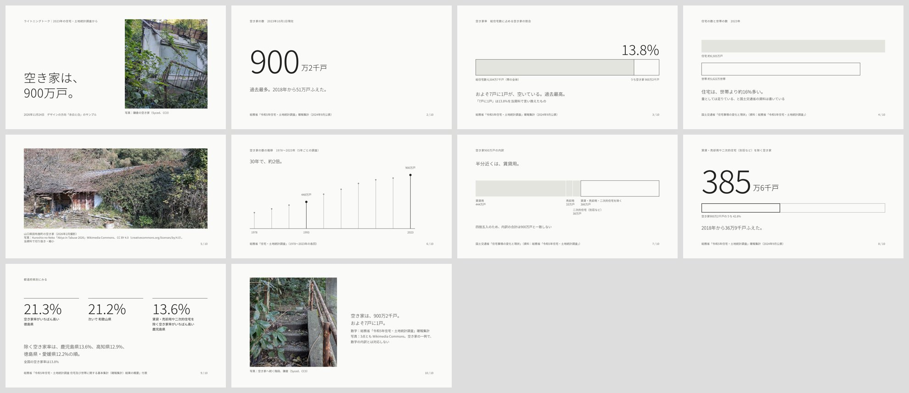

# 空き家は、900万戸。

| 項目 | 内容 |
|---|---|
| デザインシステム | [余白](../../design-systems/yohaku/) |
| デッキの型 | 登壇LT |
| 枚数 | 10枚（1920×1080） |

住宅・土地統計調査の数字を、1枚1数字と写真で見せる短い発表の見本。余白の得意技（大きな数字・空きの四角・余白の中の写真）を使っている。

## 中身

- `source/deck.json`：スライドの順番と、使うデザインシステム
- `source/deck.css`：このデッキ共通の見た目
- `source/slides/*.html`：1枚ずつのスライド
- `preview.jpg`：全スライドの一覧画像

PDF と PPTX は、リポジトリの [Releases](https://github.com/yamamonlab/slide-design-kit/releases) にあります。

## 出典

- 総務省「令和5年住宅・土地統計調査」確報集計（2024年9月公表）、付表、過去各回（1978〜2023年）
- 写真3点は Wikimedia Commons から取得し、当資料で切り抜き・縮小した（作者・ライセンスは [CREDITS.md](../../CREDITS.md)）。
- スライドの中の「当資料の計算」「当資料の言い換え」は加工の表示を兼ねる。消さない。

## メモ

- 写真は `source/photos/` にある。スライドからは `project/photos/<ファイル名>` で参照する。
