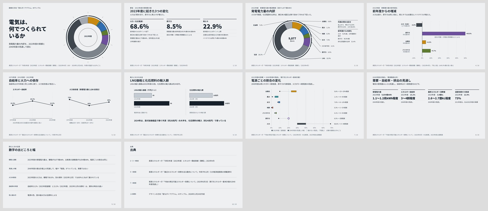

# 電気は、何でつくられているか

| 項目 | 内容 |
|---|---|
| デザインシステム | [密図](../../design-systems/mitsuzu/) |
| デッキの型 | 分析・報告 |
| 枚数 | 10枚（1920×1080） |

日本の電源構成を、輪（ドーナツ）・実績→見通しの幅・要点の列で1枚に詰めて見せる見本。

## 中身

- `source/deck.json`：スライドの順番と、使うデザインシステム
- `source/deck.css`：このデッキ共通の見た目
- `source/slides/*.html`：1枚ずつのスライド
- `preview.jpg`：全スライドの一覧画像

PDF と PPTX は、リポジトリの [Releases](https://github.com/yamamonlab/slide-design-kit/releases) にあります。

## 出典

- 資源エネルギー庁「令和5年度（2023年度）エネルギー需給実績（確報）」2025年4月
- 資源エネルギー庁「今後の再生可能エネルギー政策について」2025年6月3日
- 資源エネルギー庁「最近のエネルギー政策を巡る動向について」令和7年12月
- 言い換えた注記は出典の行に「言い換え」と書いてある。
