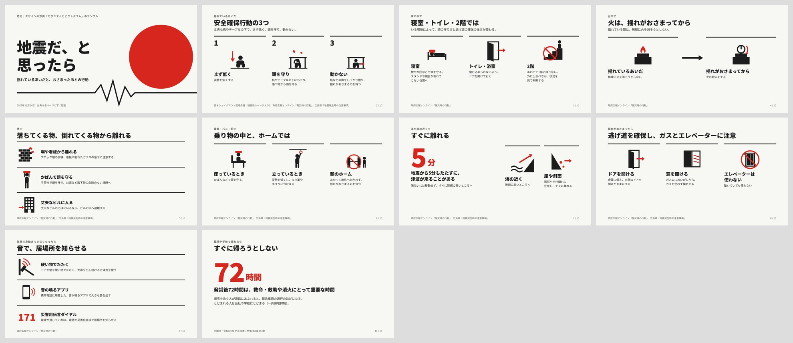

# 地震だ、と思ったら

| 項目 | 内容 |
|---|---|
| デザインシステム | [標識](../../design-systems/hyoshiki/) |
| デッキの型 | 解説・勉強会（行動の手順） |
| 枚数 | 10枚（1920×1080） |

揺れたときの行動を、記号（ピクトグラム）と短い動詞で見せる見本。記号21点はこのキットのために描いたもの。

## 中身

- `source/deck.json`：スライドの順番と、使うデザインシステム
- `source/deck.css`：このデッキ共通の見た目
- `source/slides/*.html`：1枚ずつのスライド
- `preview.jpg`：全スライドの一覧画像

PDF と PPTX は、リポジトリの [Releases](https://github.com/yamamonlab/slide-design-kit/releases) にあります。

## 出典

- 政府広報オンライン「発災時の行動」
- 広島県「地震発生時の注意事項」
- 福島県のページ（シェイクアウト）
- 内閣府「防災白書」令和8年版 特集 第3章 第4節
- 文章は当資料の言い換え。
