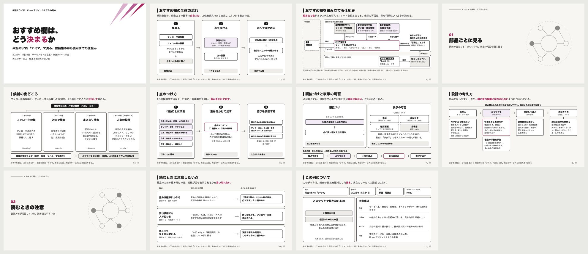

# おすすめ欄は、どう決まるか

| 項目 | 内容 |
|---|---|
| デザインシステム | [Kozu](../../design-systems/kozu/) |
| デッキの型 | 解説・勉強会 |
| 枚数 | 11枚（1920×1080） |

架空のSNS「ナミマ」を題材に、おすすめ欄が候補を集めてから表示するまでの仕組みを、構成図とパネルの流れで解説する。Kozu の得意技（構成図・パネルの流れ・論点の行・章扉）をひととおり使っている。

## 中身

- `source/deck.json`：スライドの順番と、使うデザインシステム
- `source/deck.css`：このデッキ共通の見た目
- `source/slides/*.html`：1枚ずつのスライド
- `preview.jpg`：全スライドの一覧画像

PDF と PPTX は、リポジトリの [Releases](https://github.com/yamamonlab/slide-design-kit/releases) にあります。

## 題材について

- 題材の SNS「ナミマ」、部品名、数値はすべて架空。実在のサービス・会社とは関係ない。
- 表紙と最後のスライドの「実在のサービス・会社とは関係のない例」の表記を消さない。
