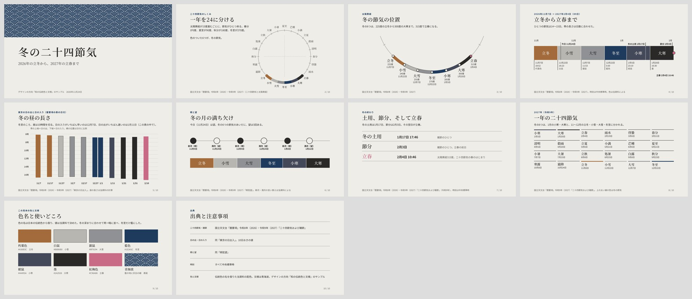

# 冬の二十四節気

| 項目 | 内容 |
|---|---|
| デザインシステム | [和色](../../design-systems/washoku/) |
| デッキの型 | 解説・勉強会 |
| 枚数 | 10枚（1920×1080） |

立冬から立春までの節気を、円弧・日数に比例した帯・伝統色で見せる見本。

## 中身

- `source/deck.json`：スライドの順番と、使うデザインシステム
- `source/deck.css`：このデッキ共通の見た目
- `source/slides/*.html`：1枚ずつのスライド
- `preview.jpg`：全スライドの一覧画像

PDF と PPTX は、リポジトリの [Releases](https://github.com/yamamonlab/slide-design-kit/releases) にあります。

## 出典

- 国立天文台「暦要項」令和8年（2026）・令和9年（2027）
- 昼の長さ・日数は当資料の計算。色の名前と値の割り当ては当資料による。
