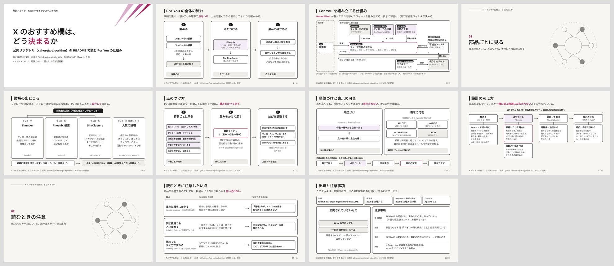

# X のおすすめ欄は、どう決まるか

| 項目 | 内容 |
|---|---|
| デザインシステム | [Kozu](../../design-systems/kozu/) |
| デッキの型 | 解説・勉強会 |
| 枚数 | 11枚（1920×1080） |

X（旧 Twitter）の「おすすめ」欄の仕組みを、公開されている README をもとに構成図とパネルの流れで解説する。Kozu の得意技（構成図・パネルの流れ・論点の行・章扉）をひととおり使っている。

## 中身

- `source/deck.json`：スライドの順番と、使うデザインシステム
- `source/deck.css`：このデッキ共通の見た目
- `source/slides/*.html`：1枚ずつのスライド
- `preview.jpg`：全スライドの一覧画像

PDF と PPTX は、リポジトリの [Releases](https://github.com/yamamonlab/slide-design-kit/releases) にあります。

## 出典

- xai-org/x-algorithm の README（Apache License 2.0）。https://github.com/xai-org/x-algorithm（2026-11-24 閲覧）
- README の記述を当資料の言葉でまとめたもの。コードは含まない。
- **X Corp.・xAI とは関係のない、個人による解説資料。** 表紙と最後のスライドの表記を消さない。

## メモ

- `x-icon`（X のアイコン）はローカルで描画すると空白になる。Claude のスライドの上では表示される。
